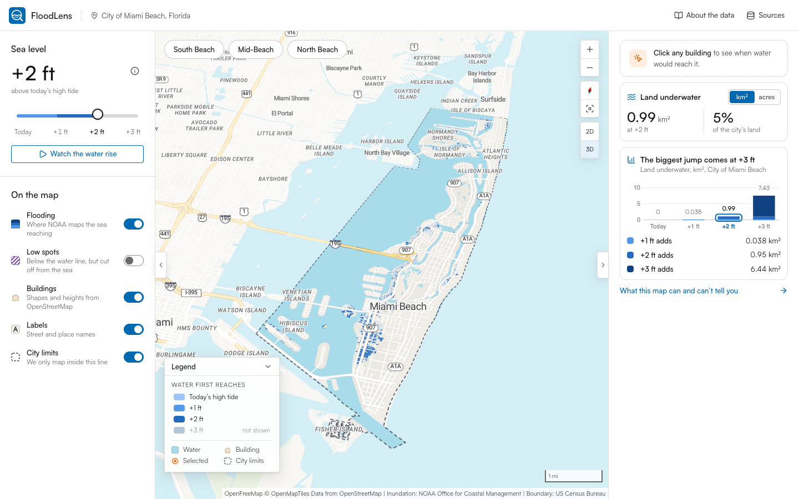
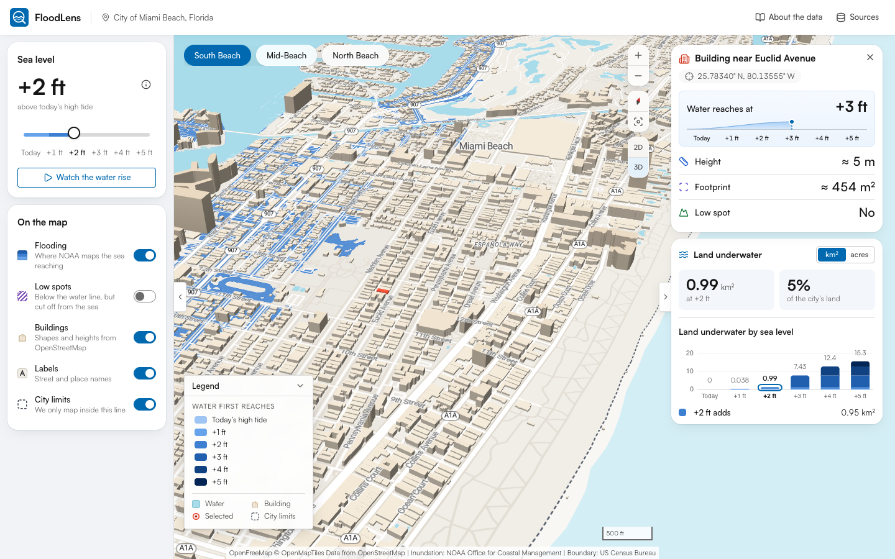
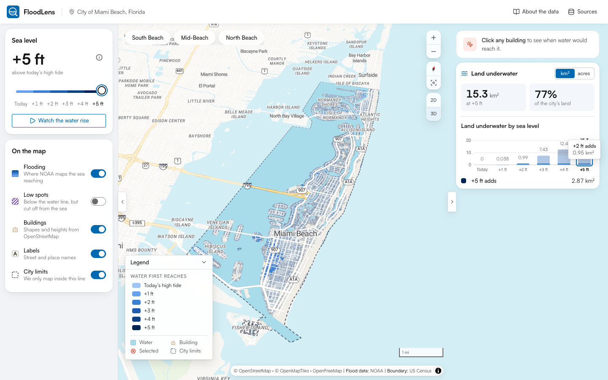

# FloodLens

**See the coastline. Understand the exposure.**

**Live:** [floodlens-five.vercel.app](https://floodlens-five.vercel.app)

FloodLens is an exploratory 3D map for comparing NOAA sea-level-rise inundation scenarios across the City of Miami Beach, Florida. It brings scenario selection, mapped inundation extents, the built environment, what each foot of rise adds and plain-language data caveats together on one screen, so a resilience planner can screen geographic exposure without opening desktop GIS software.

> Independent product design and engineering portfolio concept. Not affiliated with, sponsored by, or endorsed by NOAA, Esri, OpenFreeMap, OpenMapTiles, OpenStreetMap or the City of Miami Beach.



| South Beach in 3D with a building selected | +5 ft, spotlighting what +2 ft adds |
| --- | --- |
|  |  |

Version history with screenshots of each iteration: [CHANGELOG.md](CHANGELOG.md).

---

## Features

- **Real NOAA data.** Ocean-connected inundation polygons from the NOAA Office for Coastal Management Sea Level Rise Viewer data (FL_SE GeoPackage) for 0 ft (current MHHW) and every foot up to +5 ft, clipped to the City of Miami Beach boundary (US Census Bureau TIGER/Line; 39.4 km² including Biscayne Bay waters inside city limits). Nothing is simulated.
- **3D map (MapLibre GL JS).** A light, ArcGIS-style geographic basemap (OpenFreeMap Positron, restyled) with Roboto labels; the interface is set in Satoshi. Buildings are extruded from OpenStreetMap heights, and the overlay draws beneath basemap water so mapped inundation reads as "water reaching land".
- **Sea-level control.** A keyboard-operable slider (native range input) whose track is painted with the map's colour ramp, plus **Watch the water rise** to animate today → +5 ft. Levels swap in place, so the camera and app state are preserved.
- **Flood bands by water level.** Each area is coloured by the level at which NOAA's mapped extent first reaches it, in one blue hue that darkens as the water rises (light blue = today's high tide, dark navy = +5 ft), so one map shows how flooding spreads. The bands come from validated polygon differences computed offline. Hover a bar in the chart, or its "adds" row, to spotlight a level; the legend is a plain key.
- **In-map controls.** Zoom, compass, **Show all of Miami Beach** (fits the whole city back into view) and 2D/3D sit together inside the map, ArcGIS-style. Tilting the map by hand keeps 2D/3D in sync.
- **Area chips.** South Beach, Mid-Beach and North Beach chips (top-left) fly the camera along the 12.6 km city, keeping the current 2D/3D mode. The chip you pick fills with the accent straight away, and clicking it again shows the whole city; when you pan by hand, the nearest area's chip takes over. The named areas are camera positions only; no statistics are invented for these unofficial areas.
- **Insights.** A headline number (land underwater at the chosen level, and as a share of the city's Census land area), a stacked D3 chart of land underwater by sea level, what the selected foot adds, and (while their layer is on) the low spots cut off from the sea. A km² / acres switch shows every figure in one unit, remembered in the browser, with tooltips, keyboard focus and a screen-reader table.
- **Building and location inspection.** Click any building (3D-accurate picking) or place, or focus the map and press Enter. A card leads with the first water level that reaches it, in large type, over a track of every level (water rises and stops, with a dashed marker, at the first level that reaches it). Then OSM height, footprint (always in m²) and whether it sits in a low spot, and from which level, in one column. When none of the mapped levels reach it, the card says "Up to +5 ft · Doesn't reach it". Esc clears it.
- **Optional low-lying areas.** Hydrologically unconnected low areas are processed as a separate purple-hatched layer and are never merged with ocean-connected extents.
- **City limits layer.** The dashed city boundary and the dimmed area outside it can be turned off for a clean map.
- **Honest states.** Loading, missing-file and missing-manifest states are explicit. If data are unavailable, FloodLens shows nothing rather than an estimate.
- **Responsive and accessible.** On desktop a docked left panel and Insights cards floating over the map (380 px by default; resizable by drag or arrow keys, 300–560 px, remembered per browser). Below 1024 px the controls become a drawer and the insights a bottom sheet. Keyboard operable throughout, with visible focus, reduced-motion support and text alternatives.

## Tech stack

React 19 · TypeScript 5.9 · Vite 7 · Tailwind CSS 4 · MapLibre GL JS 5 · D3 7 · Turf 7 · Lucide icons.
Data pipeline: Python 3.9+ with Shapely 2, pyproj, pyogrio (bundled GDAL).
Tests: Vitest + Testing Library (unit and component), Playwright with the locally installed Chrome (end-to-end).

## Getting started

```bash
npm install
npm run dev            # http://localhost:5173
```

The processed data in `public/data/noaa/` are committed, so the app runs without the data pipeline.

### Scripts

| Command | What it does |
| --- | --- |
| `npm run dev` | Vite dev server |
| `npm run build` | Type-check and production build to `dist/` |
| `npm run preview` | Serve the production build |
| `npm run typecheck` | TypeScript only |
| `npm test` | Unit and component tests (Vitest) |
| `npm run test:e2e` | Browser tests (Playwright; builds and serves `dist/` automatically; needs Google Chrome installed) |
| `npm run screenshots` | Regenerate `docs/screenshots/` |
| `npm run data:prepare` | Re-run the NOAA data pipeline (see below) |

### Re-creating the data

```bash
python3 -m venv scripts/.venv
scripts/.venv/bin/pip install -r scripts/requirements.txt
scripts/.venv/bin/python scripts/prepare_noaa_slr.py --cache-dir ~/.cache/floodlens
```

The script downloads `FL_SE_slr_data_dist.zip` (977 MB; resumable, cached) and extracts the 4.1 GB GeoPackage, plus the Census TIGER/Line Florida places file (7 MB) for the city boundary. It then reads only the features that intersect the study area, so processing takes about a minute. Use `--gpkg /path/to/FL_SE_slr_final_dist.gpkg` to skip the download. Keep the cache outside synced folders such as iCloud Documents. See [DATA_SOURCES.md](DATA_SOURCES.md) for every step.

## Project structure

```
src/
  components/
    map/          MapView (MapLibre lifecycle, layers, interactions), MapControls, AreaBookmarks, MapLegend, MapStatus
    controls/     ControlPanel, ScenarioSelector
    insights/     InsightPanel, InspectionCard, LevelTrack
    charts/       ScenarioAreaChart (D3)
    dialogs/      AboutDataDialog, DataSourcesDialog
    layout/       TopBar, BrandMark
    ui/           Switch, Segmented, Dialog, Swatch, ResizeHandle
  hooks/          useManifest, useCollection, useMapData, useInspection, useMediaQuery, usePanelWidth
  lib/            manifest parsing, GeoJSON loading, geo maths, map style + layers, formatting, theme
  state/          reducer + context (sea level, layers, view mode, selection, area unit, panels)
  types/          data-manifest types
scripts/          prepare_noaa_slr.py (+ requirements.txt)
public/data/noaa/ processed GeoJSON + manifest.json
tests/e2e/        Playwright specs
docs/             design decisions, limitations, quality report, screenshots
```

Rendering and geography are kept apart from the UI. `lib/` holds pure functions with unit tests, MapView owns every MapLibre call, and the panels read a single typed reducer.

## Data and limitations, in brief

- Scenarios are **water levels above Mean Higher High Water (MHHW)**, not dates or forecasts.
- NOAA describes the data as a **screening-level** tool. They show the scale, not the exact location, of potential inundation, and do not model storm surge, erosion, subsidence or future construction.
- Extent polygons carry **no depth information**, and FloodLens shows none.
- "Within the mapped extent" is **not** a statement that a property or building will flood.
- Building heights come from OpenStreetMap through OpenMapTiles. Some are estimates.
- Data are processed **only** inside the City of Miami Beach boundary. The map dims everything outside it.

Full detail: [DATA_SOURCES.md](DATA_SOURCES.md) · [docs/LIMITATIONS.md](docs/LIMITATIONS.md).

## Deployment

FloodLens is a static site with no backend or API keys.

```bash
npm run build      # outputs dist/
```

The live site is on Vercel ([floodlens-five.vercel.app](https://floodlens-five.vercel.app)), deployed from `main` on every push; `vercel.json` sets the build and caching. Upload `dist/` to any other static host. Asset paths are relative (`base: './'`), so it also works from a sub-path such as GitHub Pages project sites. A `netlify.toml` is included. For other hosts, serve `dist/` with gzip/brotli enabled, because the GeoJSON compresses about 5×.

Basemap tiles come from the public OpenFreeMap instance (free, no key). The map's credit line keeps the required OpenStreetMap and OpenMapTiles credits, plus OpenFreeMap, NOAA and the Census Bureau. For high-traffic deployments, consider self-hosting the tiles; OpenFreeMap publishes weekly planet downloads.

## Attribution

Inundation data: NOAA Office for Coastal Management, Sea Level Rise Viewer (coast.noaa.gov/slr).
City boundary: US Census Bureau, TIGER/Line Shapefiles (public domain).
Interface font: Satoshi by Indian Type Foundry, loaded from Fontshare under the ITF Free Font License (the font files are not in this repo).
Basemap: OpenFreeMap © OpenMapTiles, data © OpenStreetMap contributors.

## Documentation

- [DATA_SOURCES.md](DATA_SOURCES.md): provenance, CRS, clipping, scenario definitions, transformation steps
- [CASE_STUDY_NOTES.md](CASE_STUDY_NOTES.md): portfolio case-study material
- [docs/DESIGN_DECISIONS.md](docs/DESIGN_DECISIONS.md): interaction, visual and technical decisions
- [docs/UX_WRITING.md](docs/UX_WRITING.md): voice, copy rules and before/after examples
- [docs/LIMITATIONS.md](docs/LIMITATIONS.md): what FloodLens can and cannot tell you
- [docs/QUALITY_REPORT.md](docs/QUALITY_REPORT.md): what was built, tested and deferred
- [CHANGELOG.md](CHANGELOG.md): numbered versions with screenshots of each iteration
